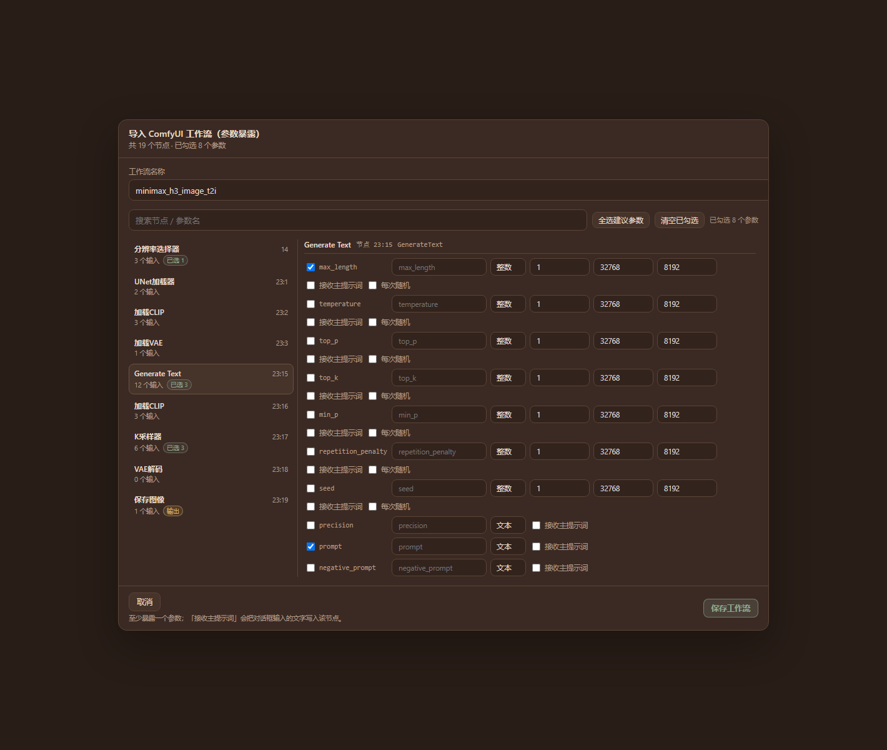
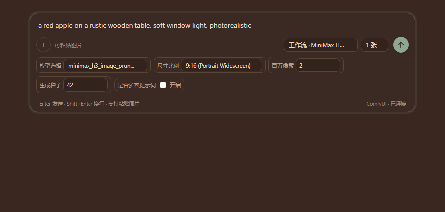
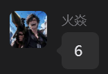

# AI Creation Workbench · dsh-creation-workbench


[中文](README.md) ｜ **English**

A personal creation workbench plugin for [DeepSeek Harness](https://github.com/deepseek-ai) (DSH): workspaces and conversations on the left, a canvas-style result grid on the right — powered either by a third-party image API or by your **local ComfyUI workflows**. Image generation is available today; image editing and video generation are next on the roadmap.

> **New here?** Follow the step-by-step guide: [Usage guide (docs/USAGE.en.md)](docs/USAGE.en.md)



ComfyUI workflows in the editor — exposed node inputs become composer controls and the prompt binds to a real text input:



---

## Contents

- [Features](#features)
- [Requirements](#requirements)
- [Install / upgrade / uninstall](#install--upgrade--uninstall)
- [Quick start](#quick-start)
- [The interface](#the-interface)
- [Current limitations](#current-limitations)
- [Roadmap](#roadmap)
- [Data and privacy](#data-and-privacy)
- [Credits](#credits)
- [Development](#development)
- [License](#license)

---

## Features

### Two image backends, both first-class

- **Third-party image APIs** in OpenAI Images or xAI (Grok Imagine) dialect, including reference images and inpainting masks.
- **Local ComfyUI workflows**: import an API-format workflow, choose which node inputs to expose, then pick the workflow in the composer and tweak its parameters.

### Interface

- **Four activity tabs**: Workspaces / Assets / Templates / Workflows — the main area follows the active tab.
- **Workspace home**: an empty conversation greets you with 「编辑 / 生成」; picking a category (image / video / audio / model) auto-selects the newest workflow of that category.
- **Workspaces, conversations, canvas**: results are grouped per turn and saved as `output-dir/workspace/conversation/image-id.png`.
- **Per-conversation memory**: prompt draft, selected workflow, parameter values, randomize flags and image count are saved and restored with the conversation.
- **Queue & task panel**: ComfyUI runs show live queue position; the 「任务」 toolbar button lists running/queued jobs across all conversations and can cancel them.

### ComfyUI workflows

- **Parameter exposure**: per input — label, type (text / int / float / bool / select), min/max/step, options, defaults, randomize (seeds); a searchable two-pane node picker.
- **Prompt binding**: one text input is explicitly bound to the composer so your prompt always reaches the workflow; unbound workflows show a clickable warning instead of silently dropping text.
- **Parameter order**: a drag-and-drop preview in the editor (drag, or use ↑↓) controls the order of the exposed params in the composer.
- **Inline randomize**: numeric params carry a 「随机」 toggle right in the composer, and the value actually used is shown after each run.
- **Smart image count**: when the workflow exposes `batch_size` the batch is queued once; otherwise the workflow is queued once per image.
- **Workflow categories**: edit / image / video / audio / model, or any custom name; the composer dropdown is grouped by category.
- **No overall timeout for local jobs**: the first run may need to load a model for minutes — jobs run until done or cancelled (third-party API jobs keep a configurable timeout).

### Prompt templates and agents

- **Template library**: category, `{{variables}}` placeholders with defaults, optional workflow-category binding, live preview.
- **`@` picker**: type `@` in the composer to search templates (↑↓ to move, Enter to insert); templates with variables ask for the values first.
- **Save as template**: capture the current composer text in one click.
- **✨ Agent templates**: mark a template as Agent with a system prompt, input types (text / image) and output format (prompt, or prompt + negative). Selecting it puts the composer into agent mode: type an idea or attach an image → generate → confirm to insert.
- **Two agent model channels**: any OpenAI-compatible endpoint (can reuse the image API base URL and key), or the **DSH host model directly** (no API key; image reverse-engineering works with vision-capable models).

### More

- Multi-image, cancel, timeout, retry, image detail view (parameters, save a copy, open folder, copy path).
- **Cost dashboard**: per-model / per-tier estimates for API backends (ComfyUI is free).
- **Local proxy onboarding**: detects common local proxy ports (Clash 7890/7897, v2rayN 10808/10809, iKuuu 12001/12003, …) with a CONNECT probe; the proxy only affects this plugin's requests.
- **Agent tool `image_generate`** — let the conversation agent generate images directly.

---

## Requirements

- DSH Desktop / Web `0.2.2-rc.1` or newer.
- A DSH profile with a manageable Plugins page.
- pnpm (bundled with DSH Desktop; otherwise install Node.js + `npm i -g pnpm`).
- Optional: a local ComfyUI instance (default `http://127.0.0.1:8188`).

---

## Install / upgrade / uninstall

From the **Plugin Market** (once listed), or directly:

```sh
# npm (once published)
dsh plugin --profile web add dsh-creation-workbench

# GitHub (recommended, newest)
dsh plugin --profile web add github:LEAFCHINA/dsh-creation-workbench
```

Or in DSH: **Plugins → Add plugin → Install**, then paste the package name, the GitHub spec, or the absolute path of a `.tgz` release.

**Upgrade**: if the profile reports `already-installed`, remove the old copy first:

```sh
dsh plugin --profile web remove dsh-creation-workbench
dsh plugin --profile web add github:LEAFCHINA/dsh-creation-workbench
```

**Upgrading from 1.x** (the package was renamed): `dsh plugin --profile web remove dsh-image-workbench`, then install the new package. Data is migrated automatically on first start.

**Uninstall**: `dsh plugin --profile web remove dsh-creation-workbench`. The data directory is left in place; delete it manually if you want a clean slate.

---

## Quick start

1. Open **AI 创作工作台** in the left sidebar → **设置** (Settings) at the bottom.
2. Pick a backend (you can configure both):

   **Third-party API** — enter the API base URL (up to `/v1`) and key, then pick or pull models; configure a proxy if your provider needs one.

   **Local ComfyUI** — enter the ComfyUI address (`http://127.0.0.1:8188`, no `/v1`) and press 「检测」(Test). In ComfyUI, export your workflow with **Save (API format)** — UI-format JSON is rejected on purpose — then press 「导入工作流」:
   - choose the inputs to expose, set labels/types/ranges/defaults;
   - bind 「主提示词 → 节点」 so composer text lands in a real text input;
   - pick a category and save.

3. Back in the composer, choose a model or 「工作流 · name」, write a prompt and press Enter.
4. Images are saved to disk and shown on the canvas; click one for details, save-as, or reveal in Explorer.

Full walkthrough and troubleshooting: **[docs/USAGE.en.md](docs/USAGE.en.md)**.

---

## The interface

| Tab | Purpose | Status |
| --- | --- | --- |
| **工作区** (Workspaces) | Workspace/conversation tree + home or canvas + composer | Available |
| **资产库** (Assets) | Browse, favourite and reuse every result across conversations | Planned (v2.4) |
| **模板** (Templates) | Template CRUD, variables, agent model settings | Available |
| **工作流** (Workflows) | Manage ComfyUI workflows by category (use / edit params / delete) | Available |

Sidebar footer: **成本看板** (cost dashboard) and **设置** (settings, with an "已配置 / 已配置 ComfyUI / 未配置" status dot).

Top bar: breadcrumbs, **任务** (cross-session running jobs), refresh current conversation.

---

## Current limitations

- ComfyUI workflow mode does **not** support reference images or inpainting masks yet (API mode does).
- **Video / audio workflow output is not parsed** yet (categories can be labelled, output cannot).
- The DSH model channel (✨ agent templates) is **text-only**; use the Agent API channel for image reverse-engineering.
- The Assets tab is a placeholder.

---

## Roadmap

- **Asset library**: index, main-area grid, detail drawer, favourites, "generate again", trash, thumbnails.
- **Image editing**: ComfyUI `LoadImage` as reference input (img2img / inpaint) plus a unified edit entry from the image detail view.
- **Video generation**: video cards on the canvas (poster + player), duration/fps/audio params, ComfyUI video workflows.
- **Global search** (conversations / assets / templates) and shortcuts.

---

## Data and privacy

- Data directory: `%USERPROFILE%\.dsh\dsh-creation-workbench\`
  - `settings.json`, `workflows.json` (ComfyUI workflows), `templates.json` (prompt templates)
  - `data\<workspace>\<conversation>.json` (conversations and image records)
  - `images\`, `uploads\`, `logs\`
- **Renamed in v2.0.0**: on first start the old `%USERPROFILE%\.dsh\dsh-image-workbench` directory is **copied** to the new location; the legacy directory is kept as a backup.
- The API key is stored **in plain text on your machine only** in `settings.json`; it is never uploaded and never logged, and the UI only shows a masked hint.
- Requests go only to the image API, agent API or local ComfyUI you configured.
- The local proxy setting applies to this plugin's requests only — never to other DSH traffic.

---

## Credits

This plugin builds on the original **AI 生图工作台 1.1.0** by **火焱** — the workspace/conversation UI, the canvas layout, the third-party image-API backend and the local-proxy onboarding all originate from that version. The ComfyUI workflow mode, the parameter editor, templates/agent features and subsequent fixes were added on top. Renamed to **AI 创作工作台 / dsh-creation-workbench** in v2.0.0 to cover image editing and video as well.

本插件基于 **火焱** 的「AI 生图工作台 1.1.0」初始版本二次开发，感谢原作者的早期实现。



---

## Development

The client half is a **prebuilt classic script** assembled from fragments in `client-src/`:

```
client-src/*.js           hand-written React.createElement (no JSX, no imports)
client.js                 built artifact (committed, so git installs need no build)
scripts/build-client.mjs  concatenates client-src in filename order
scripts/check.mjs         build freshness + syntax + dsh manifest + client id == package name
test/                     e2e / regression / client smoke (mock ComfyUI, no DSH needed)
```

```sh
npm run build:client   # rebuild client.js from client-src/
npm run check          # verify the repo is consistent
npm test               # run every test suite
```

The host half lives in `host/*.js` and is hot-reloaded by DSH: editing `host/main.js` changes the loaded revision, which re-imports the other host modules on the next request. Release process: [docs/RELEASE.md](docs/RELEASE.md).

---

## License

MIT — see [LICENSE](LICENSE).
