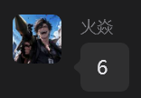

# AI 创作工作台 · dsh-creation-workbench


**中文** ｜ [English](README.en.md)

[DeepSeek Harness](https://github.com/deepseek-ai)（DSH）的个人创作工作台插件：左侧工作区 / 会话，右侧画布式排版；既能用第三方生图 API，也能直接驱动**本机 ComfyUI 工作流**。当前提供生图能力，图片编辑与视频生成在 roadmap 上。

> **想马上上手？** 看图文步骤：[使用指南（docs/USAGE.md）](docs/USAGE.md)


在编辑器里把工作流的节点输入暴露成对话框参数，并绑定主提示词：


---

## 目录

- [功能特性](#功能特性)
- [环境要求](#环境要求)
- [安装 / 升级 / 卸载](#安装--升级--卸载)
- [快速开始](#快速开始)
- [界面说明](#界面说明)
- [当前限制](#当前限制)
- [路线图](#路线图)
- [数据与隐私](#数据与隐私)
- [致谢](#致谢)
- [开发](#开发)
- [许可](#许可)

---

## 功能特性

### 两种生图后端，都是一等公民

- **第三方生图 API**：OpenAI Images 或 xAI（Grok Imagine）方言，支持参考图与局部重绘蒙版。
- **本机 ComfyUI 工作流**：导入 API 格式工作流，勾选要暴露的节点输入，之后在对话框里选工作流、调参数即可生成。

### 界面

- **活动栏四标签**：工作区 / 资产库 / 模板 / 工作流，主区域跟随标签切换。
- **工作区首页**：空会话时按时间问候，选「编辑」或「生成」（生成图片 / 视频 / 声音 / 模型），自动选中该分类最新工作流。
- **工作区 / 会话 / 画布**：生成的图片按次分组，落盘为 `保存目录/工作区/会话/图片ID.png`。
- **会话级记忆**：提示词草稿、所选工作流、参数、随机开关、张数都按会话保存与恢复。
- **队列与任务面板**：ComfyUI 任务显示实时排队位次；顶栏「任务」可跨会话查看进行中任务并取消。

### ComfyUI 工作流

- **参数暴露**：每个输入可设置名称、类型（文本 / 整数 / 小数 / 布尔 / 下拉）、最小/最大/步长、选项、默认值、是否随机（种子）；两栏可搜索的节点选择器。
- **提示词绑定**：明确指定一个文本输入接收对话框文字；未绑定时给出可点击的警告而不是静默丢字。
- **参数顺序**：编辑器里有拖拽预览，用拖动或 ↑↓ 调整参数在对话框中的排列顺序。
- **内联随机**：数值参数在对话框里直接带「随机」开关，生成后回显本次实际的值。
- **智能张数**：工作流暴露 `batch_size` 时按批量提交；没有则按张数排队多次执行。
- **工作流分类**：编辑 / 生图 / 生视频 / 生音频 / 生模型，或自定义名称；对话框下拉按分类分组。
- **本地任务不设总超时**：首次加载模型可能很慢，任务会一直跑到完成或手动取消（第三方 API 仍保留可配置超时）。
- **显存常驻可见 + 释放按钮**：对话框右下角显示 ComfyUI 显存占用；模型会一直留在显存里加快下次生成，需要时点「释放」（包括你在 ComfyUI 里加载的模型）。

### 提示词模板与 Agent

- **模板库**：模板带分类、`{{变量}}` 占位（可设默认值）、可绑定工作流分类，支持实时预览。
- **`@` 调用**：在输入框打 `@` 打开搜索面板，↑↓ 选择、Enter 插入；带变量的模板先弹小表单。
- **存为模板**：一键把当前输入存进模板库。
- **✨ Agent 模板**：模板可设为 Agent，配置 System Prompt、附加上下文、输入类型（文字 / 图片）、输出格式。选中后在侧栏创建/打开**真实的 Agent 会话**（你右它左、可多轮追问、历史落盘），结果可整段或选中片段送入输入框；也可以选「快问快答」用行内面板。
- **Agent 两套模型通道**：OpenAI 兼容 API（可复用生图 API 的地址与 Key），或**直接使用 DSH 宿主模型**（无需 API Key；支持图片反推，需选择带「支持图片」标记的模型）。

### 其他

- 多图、取消、超时、重试、图片详情（参数、保存副本、打开目录、复制路径）。
- **成本看板**：按模型 / 档位估算 API 费用（ComfyUI 免费）。
- **本地代理引导**：探测常见本地代理端口（Clash 7890/7897、v2rayN 10808/10809、iKuuu 12001/12003…）并做 CONNECT 连通验证；代理只作用于本插件的 API 请求。
- **Agent 工具 `image_generate`**：让对话 Agent 直接调用生图能力。

---

## 环境要求

- DSH Desktop / Web `0.2.2-rc.1` 或更新版本。
- 一个可管理插件的 DSH profile。
- pnpm（DSH Desktop 自带；否则装 Node.js 后 `npm i -g pnpm`）。
- 可选：本机 ComfyUI（默认 `http://127.0.0.1:8188`）。

---

## 安装 / 升级 / 卸载

**从插件市场**（收录后），或直接用命令：

```sh
# npm（发布后）
dsh plugin --profile web add dsh-creation-workbench

# GitHub（推荐，版本最新）
dsh plugin --profile web add github:LEAFCHINA/dsh-creation-workbench
```

也可以在 DSH 里：**插件 → 添加插件 → 安装**，粘贴包名、GitHub 规格或 `.tgz` 安装包的绝对路径。

**升级**：如果提示 `already-installed`，先移除旧版再装：

```sh
dsh plugin --profile web remove dsh-creation-workbench
dsh plugin --profile web add github:LEAFCHINA/dsh-creation-workbench
```

**从 1.x 升级到 2.x**（包名已改）：先 `dsh plugin --profile web remove dsh-image-workbench`，再安装新包。数据会在首次启动时自动迁移。

**卸载**：`dsh plugin --profile web remove dsh-creation-workbench`。数据目录不会自动删除，需要时可手动清理。

---

## 快速开始

1. 左侧栏点开 **AI 创作工作台** → 底部 **设置**。
2. 选择后端（二选一，可同时配置）：

   **第三方生图 API**：填写 API 地址（到 `/v1` 为止）和 Key，选择或拉取模型；需要代理就配代理。

   **本机 ComfyUI**：填 ComfyUI 地址（如 `http://127.0.0.1:8188`，不要带 `/v1`），点「检测」通过后，在 ComfyUI 里用 **保存（API 格式）** 导出工作流 JSON，回到插件点「导入工作流」：
   - 勾选要暴露的输入，设置名称、类型、范围、默认值；
   - 绑定「主提示词 → 节点」，让对话框文字写进真正的文本输入；
   - 选择分类，保存。

3. 回到对话框：选模型或「工作流 · 名称」，写提示词，回车发送。
4. 图片落盘并显示在画布上；点击可看详情、另存、在资源管理器打开。

详细步骤与排错见 **[docs/USAGE.md](docs/USAGE.md)**。

---

## 界面说明

| 标签 | 作用 | 状态 |
| --- | --- | --- |
| **工作区** | 工作区 / 会话树 + 主区首页或会话画布 + 输入框 | 可用 |
| **资产库** | 跨会话浏览、收藏、复用所有生成结果 | 规划中（v2.4） |
| **模板** | 提示词模板 CRUD、变量、Agent 模型设置 | 可用 |
| **工作流** | 按分类管理 ComfyUI 工作流（使用 / 编辑参数 / 删除） | 可用 |

侧栏底部：**成本看板**、**设置**（含「已配置 / 已配置 ComfyUI / 未配置」状态点）。

顶栏：面包屑、**任务**（跨会话进行中任务）、刷新当前会话。

---

## 当前限制

- ComfyUI 工作流模式**暂不支持参考图与局部重绘蒙版**（API 模式支持）。
- **暂不支持视频 / 音频工作流的输出**（分类可以标注，输出还不解析）。
- DSH 模型通道（✨ Agent 模板）**只支持文字输入**；图片反推提示词请用 Agent API 通道。
- 资产库标签目前是占位页。

---

## 路线图

- **资产库**：索引、主区网格、详情抽屉、收藏、再来一张、回收站、缩略图。
- **图片编辑**：ComfyUI `LoadImage` 作为参考图输入（img2img / inpaint），图片详情页统一编辑入口。
- **视频生成**：画布视频卡（封面 + 播放器）、时长/帧率/音频参数、ComfyUI 视频工作流。
- **全局搜索**（跨会话 / 资产 / 模板）与快捷键。

---

## 数据与隐私

- 数据目录：`%USERPROFILE%\.dsh\dsh-creation-workbench\`
  - `settings.json`（配置）、`workflows.json`（ComfyUI 工作流）、`templates.json`（提示词模板）
  - `data\<工作区>\<会话>.json`（会话与图片记录）
  - `images\`、`uploads\`、`logs\`
- **v2.0.0 更名迁移**：首次启动会把旧的 `%USERPROFILE%\.dsh\dsh-image-workbench` **复制**到新目录，旧目录保留作备份。
- API Key **只以明文存在本机** `settings.json`，不会上传，也不会写进日志；界面上只回显掩码。
- 请求只发往你配置的生图 API / Agent API / 本机 ComfyUI。
- 本地代理设置只作用于本插件的请求，不影响 DSH 其他流量。

---

## 致谢

本插件基于 **火焱** 的「AI 生图工作台 1.1.0」二次开发：工作区 / 会话界面、画布式排版、第三方生图 API 接入与本地代理引导均源自该版本；ComfyUI 工作流模式、参数编辑器、模板与 Agent 能力以及后续修复是在此基础上的扩展。v2.0.0 起更名为 **AI 创作工作台 / dsh-creation-workbench**，以覆盖图片编辑与视频生成。

This plugin builds on the original **AI 生图工作台 1.1.0** by **火焱** — the workspace/conversation UI, canvas layout, third-party image-API backend and local-proxy onboarding originate from that version. The ComfyUI workflow mode, parameter editor, templates/agent features and subsequent fixes were added on top.



---

## 开发

客户端是**预构建的经典脚本**，由 `client-src/` 下的片段按文件名顺序拼接：

```
client-src/*.js           手写 React.createElement（无 JSX / 无 import）
client.js                 构建产物（已提交，从 git 安装无需构建）
scripts/build-client.mjs  拼接 client-src
scripts/check.mjs         构建新鲜度 + 语法 + dsh 清单 + client id == 包名
test/                     e2e / 回归 / 客户端 smoke（mock ComfyUI，无需 DSH）
```

```sh
npm run build:client   # 重新生成 client.js
npm run check          # 一致性检查
npm test               # 全部测试套件
```

Host 侧在 `host/*.js`，由 DSH 热加载：改 `host/main.js` 会改变加载版本号，下次请求重新导入其他 host 模块。发布流程见 [docs/RELEASE.md](docs/RELEASE.md)。

---

## 许可

MIT — 见 [LICENSE](LICENSE)。
