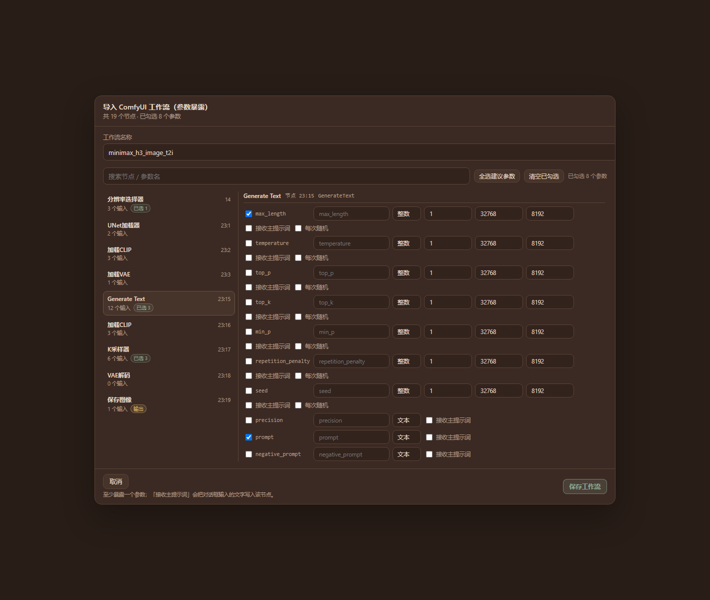
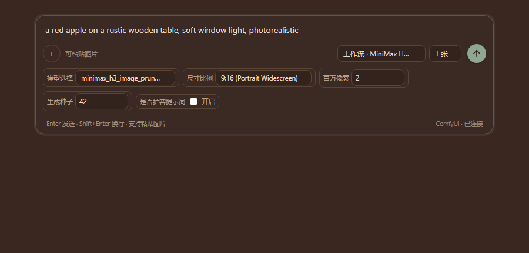

# AI 生图工作台 · dsh-image-workbench


A conversational image workbench plugin for [DeepSeek Harness](https://github.com/deepseek-ai) (DSH): workspaces and conversations on the left, a canvas-style result grid on the right — powered either by a third-party image API or by your **local ComfyUI workflows**.

DeepSeek Harness 的对话式生图插件：左侧工作区 / 会话，右侧画布式排版；支持第三方生图 API，也可以直接调用**本机 ComfyUI 工作流**。



ComfyUI workflows in the composer — the exposed node inputs become wrapping controls, the prompt binds to a real text input:



## Features

- **Two image backends, both first-class**
  - Third-party APIs in OpenAI Images or xAI (Grok Imagine) dialect, including reference images and inpainting masks.
  - **Local ComfyUI workflows**: import an API-format workflow, choose which node inputs to expose, then pick the workflow in the composer and tweak its parameters.
- **Workspaces, conversations, canvas** — generated images are grouped per turn and saved as `保存目录/工作区/会话/图片ID.png` on disk.
- **ComfyUI parameter exposure** — per input: label, type (text / int / float / bool / select), min/max/step, options, default, randomize (seeds); searchable two-pane node picker.
- **Inline per-generation controls** — numeric params carry a **随机** toggle right in the composer, and the value that was actually drawn is shown after each run. The **张数** selector only appears when the workflow exposes a `batch_size` input; a workflow without it runs once per send.
- **Prompt binding** — one exposed text input is explicitly bound to the composer, so the prompt you type always reaches the workflow. Unbound workflows show a clickable warning instead of silently dropping the text.
- **Multi-image, cancel/timeout, retry, image detail view**.
- **Local files** — configurable image directory, save-as, open folder, copy path.
- **Cost dashboard** — per-model / per-tier estimate for the API backends (ComfyUI is free).
- **Local proxy onboarding** — detects common local proxy ports (Clash 7890/7897, v2rayN 10808/10809, iKuuu 12001/12003, …) with a CONNECT probe; the proxy only affects this plugin's API requests, never other DSH traffic.
- **Agent tool** `image_generate` — let the conversation agent generate images directly.

## Requirements

- DSH Desktop / Web `0.2.2-rc.1` or newer (tested on `0.2.2-rc.1`).
- A DSH profile with a manageable **Plugins** page.
- pnpm (bundled with DSH Desktop; otherwise install Node.js + `npm i -g pnpm`).
- Optional: a local ComfyUI instance (default `http://127.0.0.1:8188`).

## Install

From the **Plugin Market** (once listed), or directly:

```sh
# npm
dsh plugin --profile web add dsh-image-workbench

# GitHub
dsh plugin --profile web add github:LEAFCHINA/dsh-image-workbench
```

Or in DSH: **Plugins → Add plugin → Install**, pasting the package name, the GitHub spec, or the absolute path of the `.tgz` release.

To upgrade an existing install, remove the old copy first if the profile reports `already-installed`.

## Quick start

1. Open **AI 生图工作台** in the left sidebar → **⚙ Settings**.
2. Pick a backend:

   **Third-party API** — fill the API base URL (up to `/v1`) and key, then pick models (or pull them from the host). Configure a proxy if your provider needs one.

   **Local ComfyUI** — set the ComfyUI address (`http://127.0.0.1:8188`, no `/v1`) and press **检测 / Test**. In ComfyUI, export your workflow with **Save (API format)** — the UI-format JSON is rejected on purpose — then **Import workflow**:
   - pick the inputs to expose, set their labels/types/ranges/defaults;
   - bind **主提示词 → 节点** so the composer text lands in a real text input (an empty text input is suggested automatically);
   - save the workflow.
3. In the composer choose the model or **工作流 · name**, write the prompt, and send.
4. Generated images are saved under the configured directory and shown on the canvas; open one for details, save-as, or reveal in Explorer.

### ComfyUI limits (v1)

- Reference images and the inpainting mask are **not** supported in workflow mode.
- Video workflows are not supported.
- `n images`: if the workflow exposes a `batch_size` input it is queued once with that batch size; otherwise the workflow is queued `n` times.

## Data and privacy

- Data directory: `%USERPROFILE%\.dsh\dsh-image-workbench\` (`settings.json`, `workflows.json`, `images/`, `logs/`).
- The API key is stored **in plain text on your machine only** in `settings.json`; the plugin never uploads it and never logs it.
- Requests go only to the image API you configured or to your local ComfyUI.
- The local proxy setting applies to this plugin's API requests only.

## Development

The client half is a plain classic script assembled from fragments:

```
client-src/*.js   # hand-written React.createElement code, no JSX, no imports
client.js         # built artifact (committed, so installs from git need no build)
scripts/build-client.mjs  # concatenates client-src in filename order
scripts/check.mjs         # build freshness + syntax + dsh manifest checks
```

```sh
npm run build:client   # rebuild client.js from client-src/
npm run check          # verify the repo is consistent
```

The host half lives in `host/*.js` and is hot-reloaded by DSH: editing `host/main.js` changes the loaded revision, which re-imports the other host modules on the next request.

## License

MIT — see [LICENSE](LICENSE).
